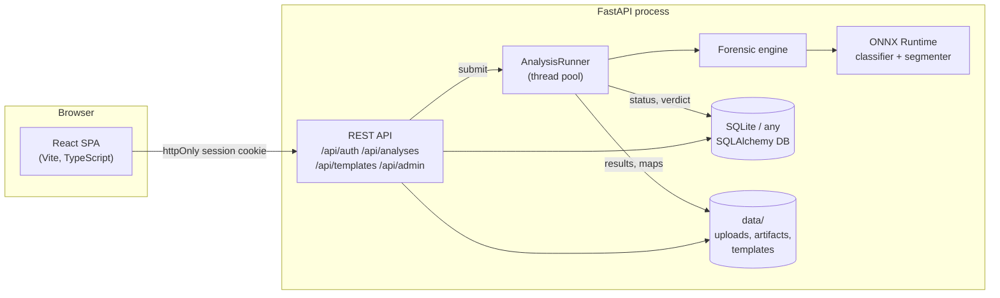

# Architecture



The v1 project was a React app plus a separate Express/MongoDB auth server with no analysis code.
v2 is one Python service: the forensic engine is a plain library (`docauth.forensics`) used by the
API, the CLI and the training/evaluation scripts alike, so there is a single implementation of
every check.

## Request flow

1. `POST /api/analyses` (multipart) - the file type is identified from magic bytes, size-limited,
   stored under a random name and recorded as `queued`; the response returns immediately (202).
2. The `AnalysisRunner` thread pool loads the document (images, or up to N PDF pages - scanned
   PDF pages use the embedded JPEG directly so its compression traces survive), resolves the
   chosen or auto-detected template and runs the engine.
3. The engine runs each module in isolation, fuses their evidence and writes page images plus
   heatmaps/overlays (`data/analyses/<id>/`). The JSON report and verdict go to the database.
4. The SPA polls `GET /api/analyses/{id}` until `done`, then renders overlays via
   `GET /api/analyses/{id}/files/{name}` and can download `report.pdf`.
5. Work interrupted by a restart is re-queued on start-up.

## Code map

```
backend/docauth/
  app.py, main.py          FastAPI factory (CORS, security headers, SPA serving), ASGI entry
  config.py                settings from env / .env (DOCAUTH_*)
  db.py, models.py         SQLAlchemy 2 models: User, Template, Analysis
  security.py              bcrypt, JWT, login throttling
  api/                     auth, analyses, templates, admin, health routers
  services/                jobs (runner), storage, PDF report
  forensics/
    loader.py              bytes -> Document(pages) for images and PDFs
    engine.py              module orchestration, fusion, artifact saving
    modules/               metadata, ela, noise, jpeg, copymove, template
    deep/                  ONNX runtime + CNN classifier / segmentation modules, weights/
  synth.py                 synthetic certificate + forgery generator
  cli.py                   docauth analyze | serve | create-admin | seed-demo
frontend/src/              pages/, components/, api.ts (typed client), auth.tsx
ml/                        datasets, models, training, ONNX export, evaluation/calibration
```

## Security

* Passwords: bcrypt (cost 12), 8+ characters mixing letters with digits/symbols; >72-byte
  passwords are rejected rather than silently truncated.
* Sessions: HS256 JWT in an `httpOnly`, `SameSite=Lax` cookie (`Secure` with
  `DOCAUTH_COOKIE_SECURE=true`); a Bearer header is accepted for API clients. Production refuses
  to start without `DOCAUTH_SECRET_KEY`.
* Failed logins are throttled per email + IP; unknown emails and wrong passwords return the same
  message and take the same time.
* Every analysis/artifact endpoint checks ownership (admins see all) and answers 404 rather than
  403 for other users' IDs. Artifact names are whitelisted (`[a-z0-9_].png|jpg`), so no path
  traversal. Uploads are identified by content, never by extension or Content-Type, and images are
  guarded against decompression bombs.
* Responses carry `X-Content-Type-Options: nosniff`, `X-Frame-Options: DENY` and
  `Referrer-Policy: same-origin`.

## Configuration

All settings are environment variables with the `DOCAUTH_` prefix (see `.env.example`):
data directory, database URL, secret key, admin bootstrap account, registration toggle,
cookie security, CORS origins, upload/page limits and worker count.
